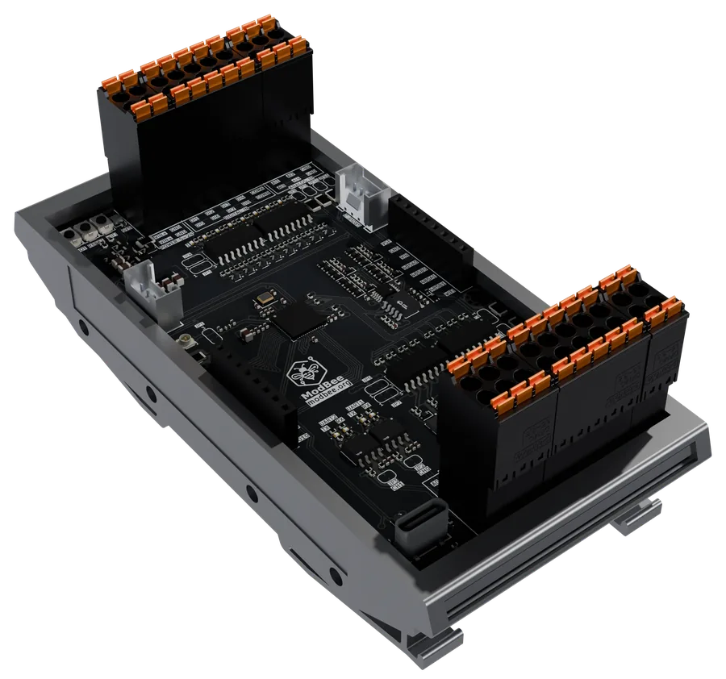

# modbee-openplc

Function block libraries for OpenPLC, and the board package for the
**ModBee Node UIO**.



They are for electricians and integrators who build control panels with
OpenPLC. You get the protocols a remote site needs (BeeBus, Modbus, MQTT,
Sparkplug B, cellular), the Node UIO's own I/O, and a library of ready-made
blocks for motors, pumps, valves and alarms. Every block works from Ladder,
FBD and Structured Text, and every library runs on a board as well as on the
OpenPLC Runtime unless its docs say otherwise.

## Start here

New to OpenPLC or the Node UIO? The **[getting started guide](docs/README.md)**
walks you through it with a screenshot for every step:

1. [Overview](docs/01-overview.md): the pieces and how they fit together
2. [Install](docs/02-install.md): the editor, the board package and the libraries
3. [First project](docs/03-first-project.md): the Node UIO and PLC tasks
4. [First Ladder program](docs/04-first-ladder.md): build, upload and watch it run
5. [Next steps](docs/05-next-steps.md)

## Download

| What | Where |
| --- | --- |
| **ModBee OpenPLC Editor** (Windows, macOS, Linux) | [mod-bee/openplc-editor releases](https://github.com/mod-bee/openplc-editor/releases/latest) |
| **All libraries in one file**, `modbee-openplc-libraries.zip` | [latest release](https://github.com/mod-bee/modbee-openplc/releases/latest) |
| Each library on its own, `<library>-<version>.stlib` | [latest release](https://github.com/mod-bee/modbee-openplc/releases/latest) |
| Node UIO board package, `com.modbee.node-<version>.vpp` | [latest release](https://github.com/mod-bee/modbee-openplc/releases/latest) |

These libraries and the board package need the **ModBee OpenPLC Editor**. The
standard OpenPLC Editor cannot use them until ModBee's changes are merged into
OpenPLC. The ModBee editor follows OpenPLC and is kept up to date with it.
[Why the ModBee editor](docs/01-overview.md#why-the-modbee-openplc-editor).

## What is here

### Communication: `modbee-communication/`

| Library | What it does | Docs |
| --- | --- | --- |
| `modbee-beebus` | BeeBus between PLCs and HMIs: shared registers and published topics, over serial, Wi-Fi, Ethernet or UDP, with no master and no polling | [docs](modbee-communication/modbee-beebus/docs/README.md) |
| `modbee-modbus` | Modbus RTU, ASCII and TCP: read and write other devices, answer as a device, or bridge TCP onto RS-485 | [docs](modbee-communication/modbee-modbus/docs/README.md) |
| `modbee-mqtt` | MQTT 5.0 and 3.1.1, plain or TLS, and Sparkplug B. The PLC can also be the site broker or bridge two brokers | [docs](modbee-communication/modbee-mqtt/docs/README.md) |
| `modbee-gsm` | A cellular modem: SMS in and out, a TCP or TLS socket, signal, network time, GPS, and MQTT over cellular | [docs](modbee-communication/modbee-gsm/docs/README.md) |
| `modbee-ota` | Firmware updates over MQTT from inside the PLC program, with optional signing and automatic roll-back | [docs](modbee-communication/modbee-ota/docs/README.md) |

### Hardware: `modbee-hardware/modbee-hardware-arduino/modbee-node-uio/`

| Folder | What it is | Docs |
| --- | --- | --- |
| `node-uio` | The Node UIO's I/O: 8 digital in, 8 digital out, 4 analog in and 2 analog out with calibration, HAT power, network, sleep and restart | [docs](modbee-hardware/modbee-hardware-arduino/modbee-node-uio/node-uio/docs/README.md) |
| `node-webUI` | A web page on the board: live digital and analog channels, and the analog calibration | [docs](modbee-hardware/modbee-hardware-arduino/modbee-node-uio/node-webUI/docs/README.md) |
| `node-vpp` | The board package (`com.modbee.node`) that adds **ModBee Node UIO** as a target, with its 2 MB PSRAM enabled | [README](modbee-hardware/modbee-hardware-arduino/modbee-node-uio/node-vpp/README.md) |

### Applications: `modbee-libraries/`

| Library | What it does | Docs |
| --- | --- | --- |
| `modbee-utilities` | Ready-made blocks for motors (DOL, reversing, star-delta, two-speed, VSD), pumps and pump stations, valves, dosing, signals, run hours and totals, alarms and HMI messages, and sequences. Every block that can stop equipment says on the HMI what it is doing and why | [docs](modbee-libraries/modbee-utilities/docs/README.md) |
| `modbee-devices` | One ready-made block per field device on Modbus, with the device's registers and scaling built in. First device: the 7-in-1 RS-485 soil sensor | [docs](modbee-libraries/modbee-devices/docs/README.md) |

## For maintainers: building from source

Each library folder is an OpenPLC library project: `library.json`, the blocks
in `pous/`, the data types in `datatypes/`, its documentation in `docs/`, and,
for the libraries with C++ blocks, the C++ code they compile against in
`resources/`. That code goes into the library when it is built, so there is
nothing else to install.

The C++ code is not kept here. Each library's `sources.json` names the GitHub
repository and release tag its code comes from (for example
`mod-bee/modbee-mqtt` at `v0.1.0`), and `tools/fetch-sources.mjs` fetches it
into `resources/`. Code that exists only here, such as the vendored wolfSSL in
`modbee-mqtt`, stays committed in `resources/`.

To build a library yourself:

1. Fetch the C++ code, then open the library's folder in the OpenPLC Editor as
   a project and build it. The build writes `build/<library>.stlib`. With the
   command line tool:

   ```bash
   node tools/fetch-sources.mjs
   openplc-cli library build modbee-communication/modbee-mqtt
   ```

2. Install the `.stlib` in the editor, or with
   `openplc-cli library install modbee-communication/modbee-mqtt/build/modbee-mqtt.stlib`.

Releases are built by the GitHub workflow `.github/workflows/release.yml` with
`tools/build-release.mjs`: pushing a `v*` tag builds every library and the
board package with the ModBee editor's command line tool and publishes them.

Libraries are made to be installed side by side. Every block and type name
carries its library's prefix (`BEEBUS_`, `MODBUS_`, `MQTT_`, `GSM_`, `OTA_`, `UT_`, `DEV_`),
because the editor checks a new name against every installed library, not
only the ones a project uses.

## Licence

ModBee's own code is licensed under the GNU Affero General Public License,
version 3, with additional terms: it is for non-commercial use, and any
commercial use needs a separate commercial licence. To ask about one, write to
info@modbee.org.

Third-party code carried in a library's `resources/` keeps its own licence,
given in its folder (a licence file or the file headers). For example, wolfSSL
in `modbee-mqtt` is under the GPL version 3, and the ADS1X15 and GP8XXX drivers
in `node-uio` are under the MIT licence.
