# 2. Install

You install three things: the editor, the Node UIO board package and the
ModBee libraries. The board package and the libraries are installed from
inside a project, so this page also creates your first project.

## Download

| What | Where |
| --- | --- |
| ModBee OpenPLC Editor | [mod-bee/openplc-editor releases](https://github.com/mod-bee/openplc-editor/releases/latest) |
| Board package `com.modbee.node-<version>.vpp` | [this repository's releases](https://github.com/mod-bee/modbee-openplc/releases/latest) |
| All libraries `modbee-openplc-libraries.zip` | [this repository's releases](https://github.com/mod-bee/modbee-openplc/releases/latest) |

Pick the editor file for your computer:

| Computer | File |
| --- | --- |
| Windows (most PCs) | `ModBee.OpenPLC.Editor_<version>.exe` |
| Windows on ARM | `ModBee.OpenPLC.Editor_<version>-ARM64.exe` |
| Mac with Apple silicon (M1 and later) | `ModBee_OpenPLC_Editor_<version>-ARM.dmg` |
| Mac with an Intel processor | `ModBee_OpenPLC_Editor_<version>.dmg` |
| Linux (most PCs) | `ModBee.OpenPLC.Editor-<version>.AppImage` |
| Linux on ARM (for example, a Raspberry Pi) | `ModBee.OpenPLC.Editor-<version>-ARM64.AppImage` |

## Install the editor

- **Windows:** run the `.exe` and follow the installer.
- **Mac:** open the `.dmg` and drag the editor into Applications.
- **Linux:** make the AppImage executable (right-click › Properties ›
  Permissions › *Allow executing file as program*, or
  `chmod +x ModBee.OpenPLC.Editor-*.AppImage`), then double-click it.

Start the editor. You see the start screen:

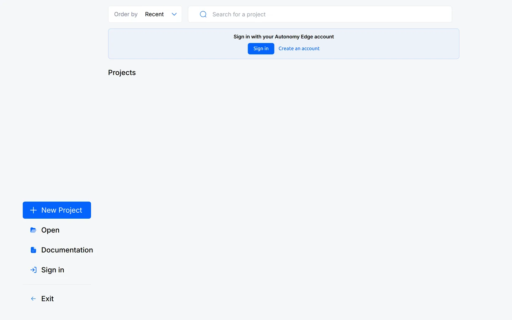

**New Project** creates a project. **Open** opens one from disk, and your
recent projects are listed on the right. You can ignore the *Sign in* box: an
Autonomy Edge account is optional and not needed for anything in this guide.

## Create a project

A project is a folder holding your program, its settings and the board it
runs on. Make an empty folder for it first, for example
`Documents/OpenPLC/My First Node`.

1. Click **New Project**, choose **PLC Project** and click **Next**.

   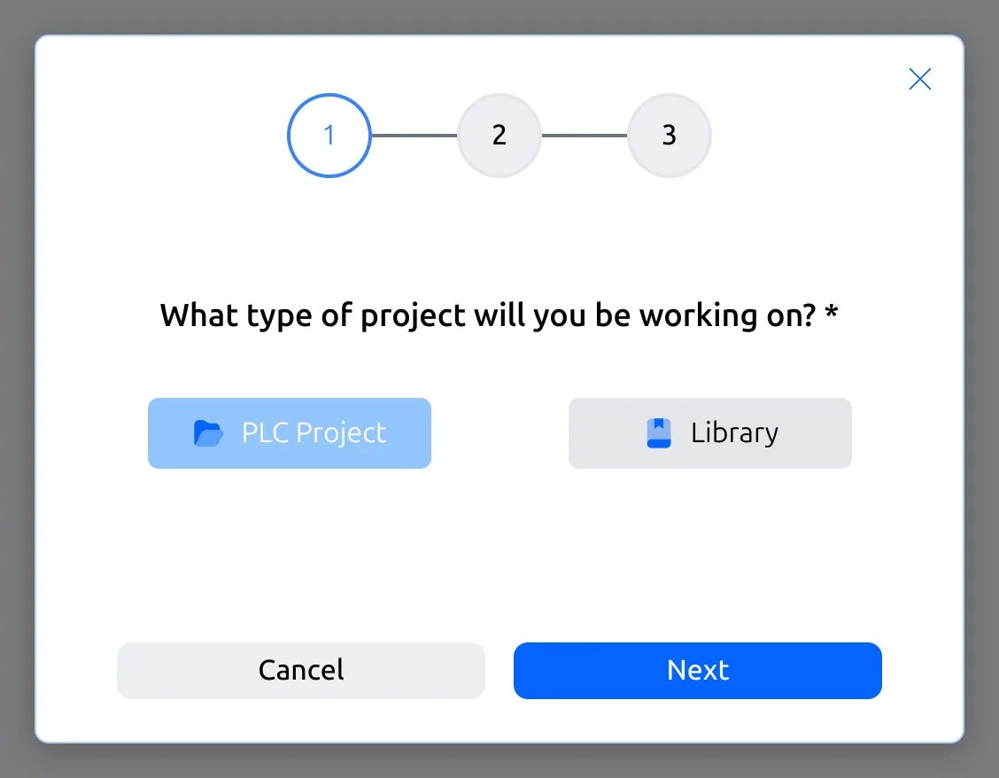

2. Type a name, click the folder box, pick your empty folder and click
   **Next**.

   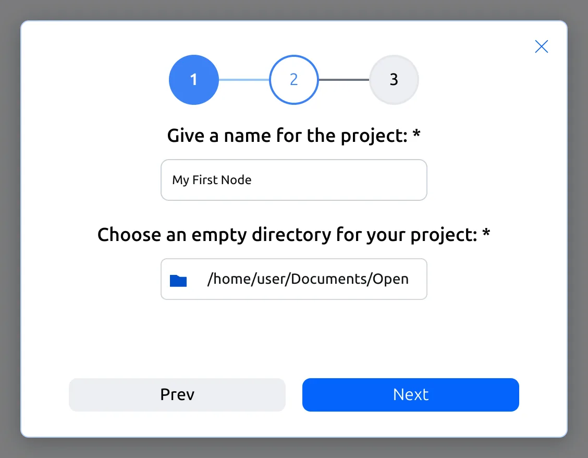

3. Choose **Ladder Diagram** as the language for the main program. Leave the
   cyclic task time at `T#20ms` (page 3 explains it). Click **Create Project**.

   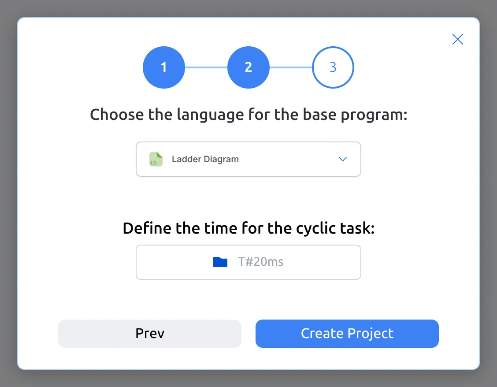

The project opens in the workspace:

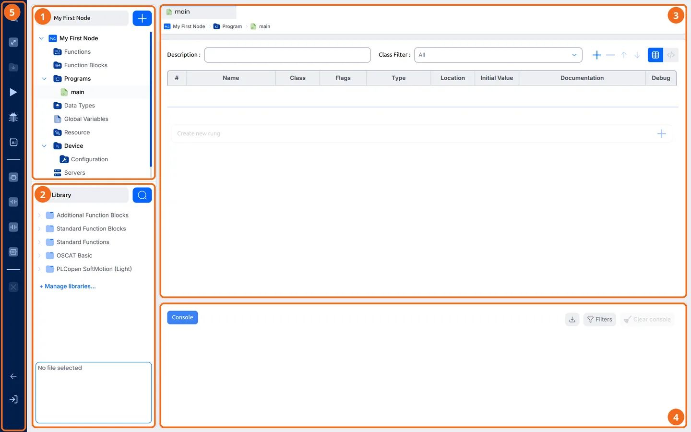

1. **Project tree:** your programs, data types, global variables, the
   Resource (tasks) and the Device (board settings).
2. **Library:** the blocks you can use. **+ Manage libraries…** opens the
   Library Manager.
3. **Editor:** the open item. Here it is the program `main`, with its
   variables table at the top and its Ladder rungs below.
4. **Console:** messages from the editor, builds and uploads.
5. **Tool bar:** build and upload, run, and the live debugger.

## Install the board package

The board package adds the ModBee Node UIO to the list of boards.

1. In the project tree, open **Device › Configuration**. Click the **Device**
   box. It lists only the OpenPLC targets the editor comes with. Click
   **+ Install additional boards…** at the bottom of the list.

   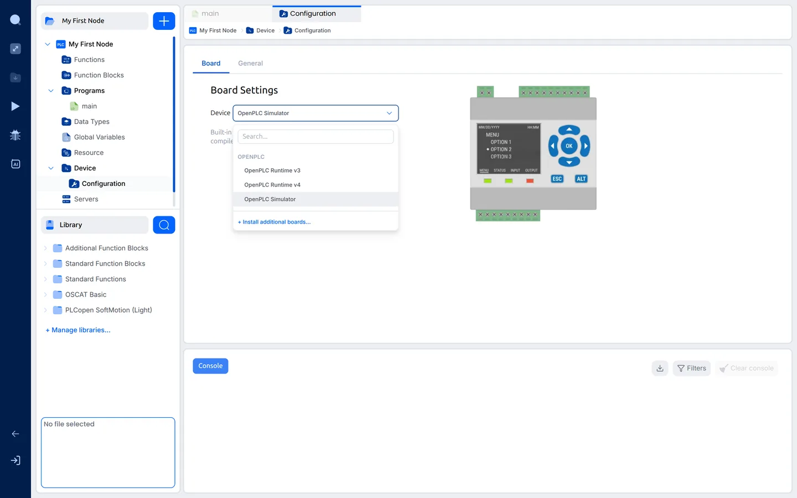

   (The Package Manager is also under **File › Board Package Manager…**.)

2. The Package Manager opens. Click **+** and then **Add from file…**.

   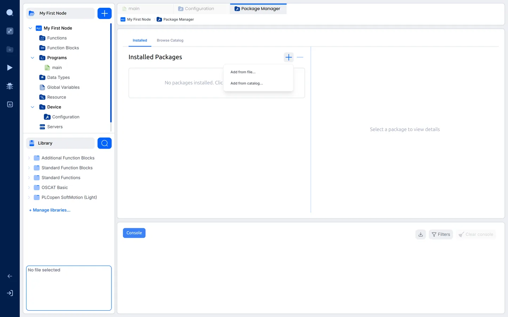

3. Pick the `com.modbee.node-<version>.vpp` you downloaded. The package
   appears under **Installed Packages**, and clicking it shows its details:

   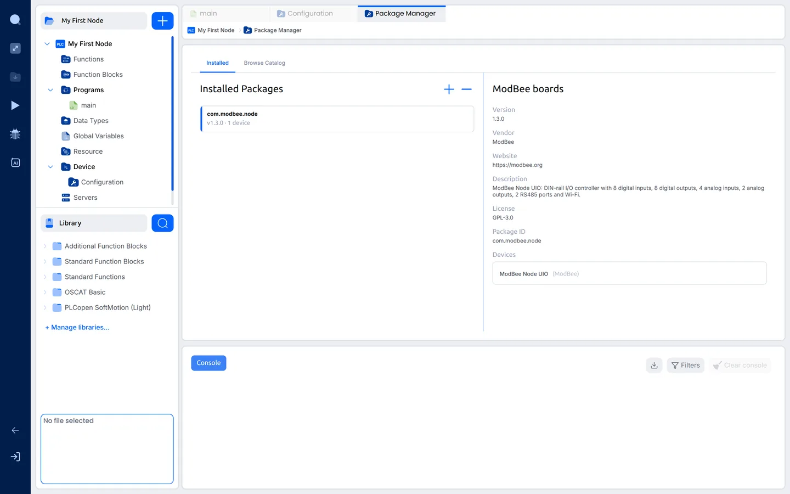

You do this once per computer. To update the package later, add the newer
`.vpp` the same way.

## Install the libraries

Libraries are installed once per computer, and then switched on for each
project that uses them (page 3).

1. In the **Library** panel, click **+ Manage libraries…**. The Library
   Manager opens on **System Libraries**: the libraries on this computer.
   The ones marked *bundled* come with the editor.

   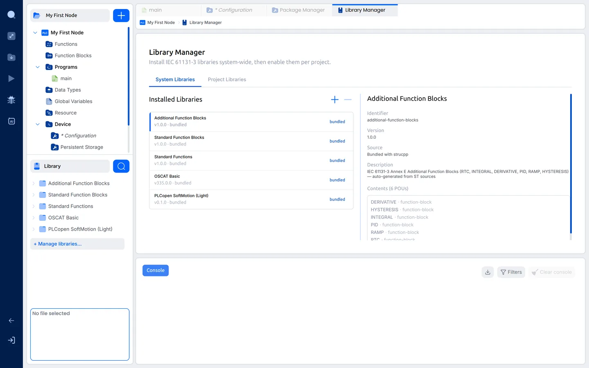

2. Click **+** and then **Add from file…**.

   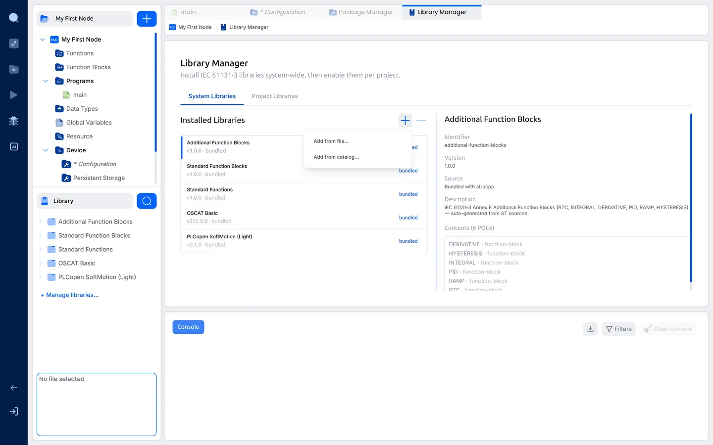

3. Pick one of these:

   - **`modbee-openplc-libraries.zip`** installs every ModBee library in one
     step. This is the easiest way.
   - **One `.stlib` file** installs that library on its own. Install the
     libraries it needs as well. The release notes list them in the *Needs*
     column, for example *OTA* needs *MQTT*, and *ModBee Node UIO Web UI*
     needs *ModBee Node UIO*.

   The new libraries join the list:

   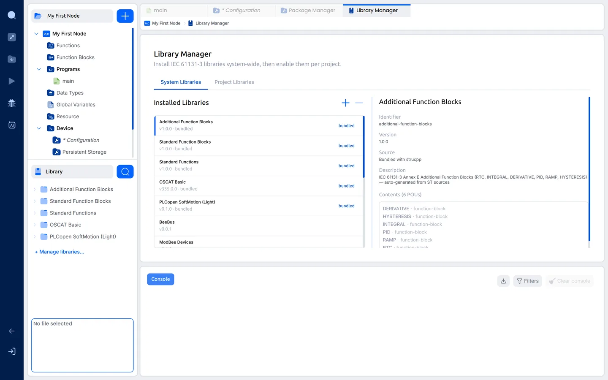

To update a library, install the newer file the same way.

Next: [3. First project](03-first-project.md)
