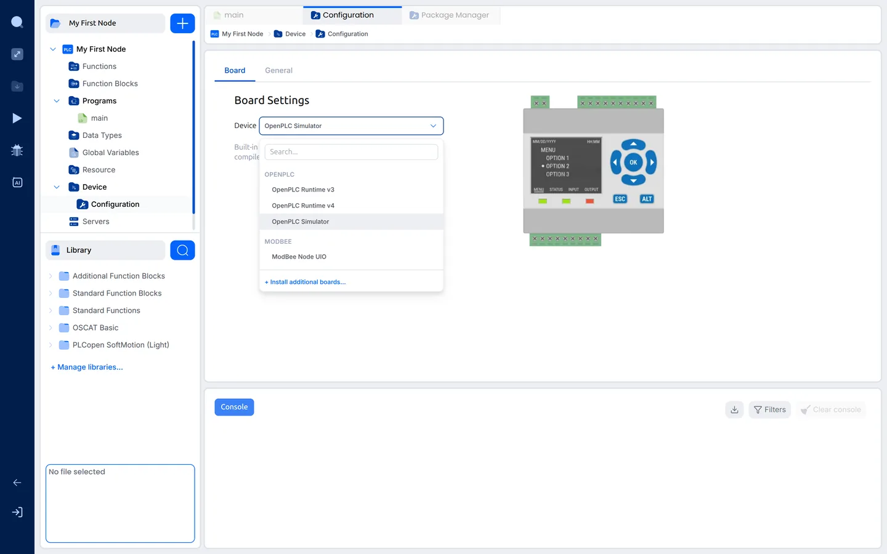
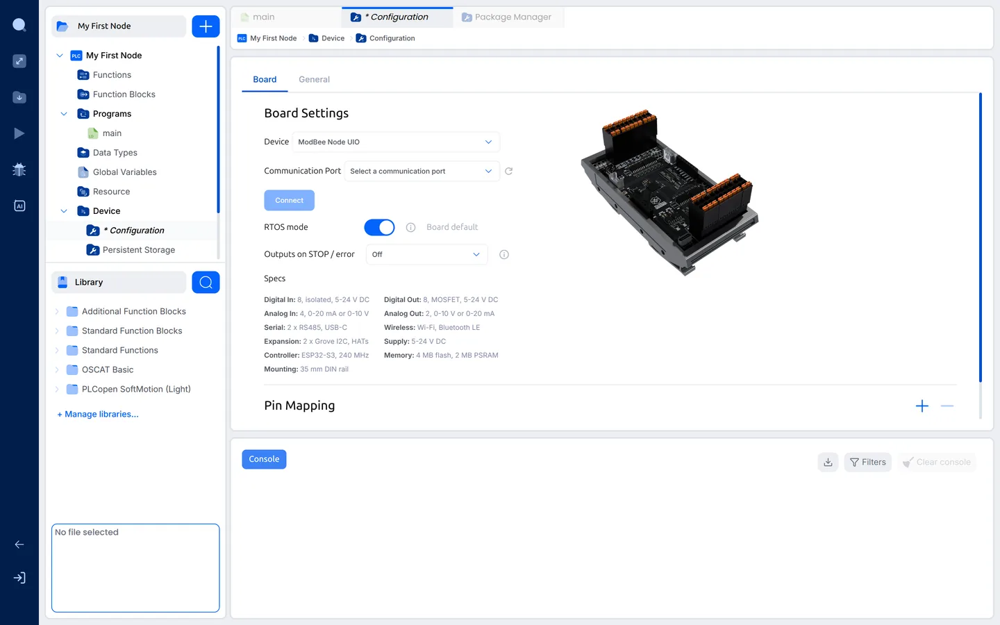
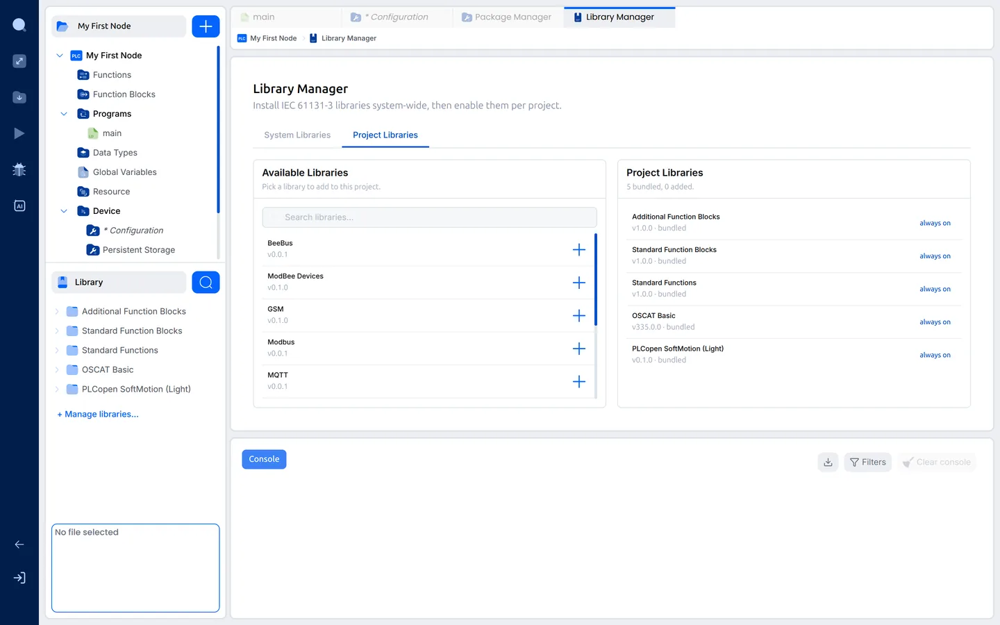
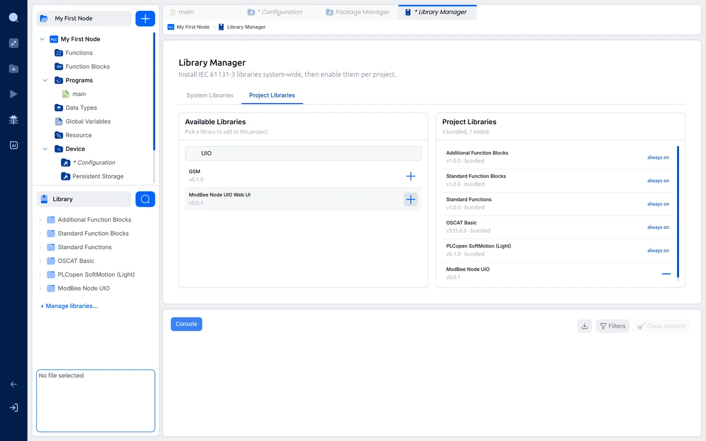
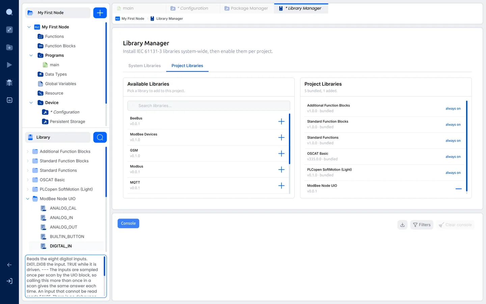
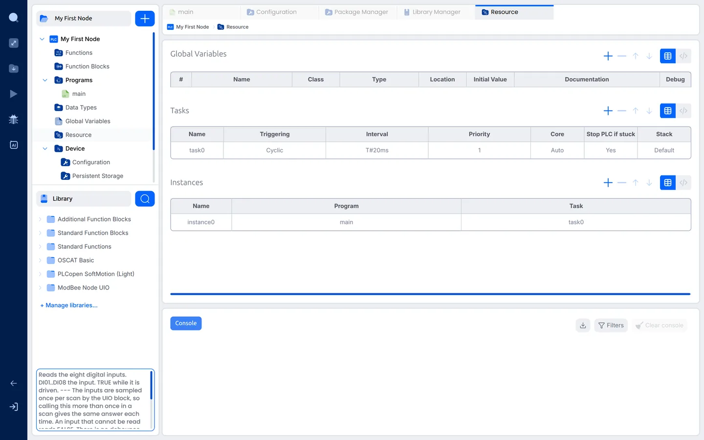

# 3. First project

The project from page 2 still targets the OpenPLC Simulator and uses no
ModBee libraries. This page points it at the Node UIO, switches on the
library for the board's I/O, and explains the PLC tasks that run your
program.

## Choose the board

1. Open **Device › Configuration** and click the **Device** box. The
   **MODBEE** group now holds the **ModBee Node UIO**. Click it.

   

2. The board's settings and specifications appear:

   

   - **Communication Port:** the USB port the Node UIO is on. You set it on
     page 4, when the board is plugged in.
   - **RTOS mode:** each PLC task runs as its own real-time task on the
     board. Leave it on (the board's default).
   - **Outputs on STOP / error:** what the outputs do when the PLC is stopped
     or goes into error. **Off** switches every output off, which is the safe
     choice for most plant. **Hold** keeps each output at its last value.
   - **Specs:** what the board has, for reference.

3. Save the project: **File › Save Project** (Ctrl+Shift+S).

## Switch on the libraries the project uses

Installed libraries are available to every project, but a project only shows
the blocks of the libraries you switch on for it. That keeps each project's
block list short.

1. Click **+ Manage libraries…** and open the **Project Libraries** tab.
   *Available Libraries* on the left are installed but not used yet.
   *Project Libraries* on the right are in this project. The bundled ones
   are always on.

   

2. Type `UIO` in the search box and click **+** next to
   **ModBee Node UIO**. It moves to *Project Libraries*, and a
   **ModBee Node UIO** folder appears in the **Library** panel with the
   board's blocks.

   

Open the folder and click a block to read what it does and what each pin is
for, in the box below the library tree:

Every Node UIO project needs **ModBee Node UIO**. Add the others when you
use them, for example **Modbus** for an RS485 sensor or **MQTT** to report to
a SCADA system.

## PLC tasks

Open **Resource** in the project tree.

A PLC does not run your program once, like a script. It runs it over and
over. Each run is a **scan**: it reads the inputs, works through the program
and sets the outputs. A **task** decides when the scans happen.

The **Tasks** table has one task, `task0`, made by the New Project wizard:

| Column | Value | Meaning |
| --- | --- | --- |
| Name | `task0` | The task's name. You can rename it, for example to `LOGIC`. |
| Triggering | Cyclic | Run a scan at a fixed interval. |
| Interval | `T#20ms` | Time between scans: 20 ms is 50 scans a second. Fast enough for most plant. Use a shorter time only for fast signals. |
| Priority | `1` | Which task goes first when two are due at once. **0 is the highest.** |
| Core | Auto | Which processor core runs the task. *Auto* runs it on the core the PLC runtime starts on, which on the Node UIO is core 1, away from the Wi-Fi on core 0. Leave it on *Auto*, or set *Core 1*. |
| Stop PLC if stuck | Yes | If a scan never finishes, *Yes* stops the PLC, and the outputs go to the **Outputs on STOP / error** setting. *No* reports it and keeps the other tasks running. |
| Stack | Default | Memory for the task's working data. *Default* is the board's own size (16 KB on the Node UIO) and suits almost every program. |

The **Instances** table says which program each task runs: `instance0` runs
the program `main` in `task0`.

**One task is enough to start with.** Larger projects often split the work
into two: a **LOGIC** task for the plant control, with a high priority, and a
**COMMS** task for Modbus, MQTT and HMI links, with a lower one. A slow
network then never holds up the control logic. Keep the board's I/O blocks
(`UIO`, `DIGITAL_IN`, `DIGITAL_OUT` and the others) together in one task.

Next: [4. First Ladder program](04-first-ladder.md)
