# 4. First Ladder program

You build a small program on the project from page 3, compile it, upload it
to the Node UIO and watch it run:

- a switch on **DI1** turns a lamp on **DO1** on and off;
- a switch on **DI2** starts a pump on **DO2**, but only after it has been on
  for 5 seconds.

## Wiring

Wire a switch to each of DI1 and DI2, and a lamp or a relay to each of DO1
and DO2. The Node UIO's wiring guide in the
[modbee-node-uio repository](https://github.com/mod-bee/modbee-node-uio)
shows how inputs and outputs connect:

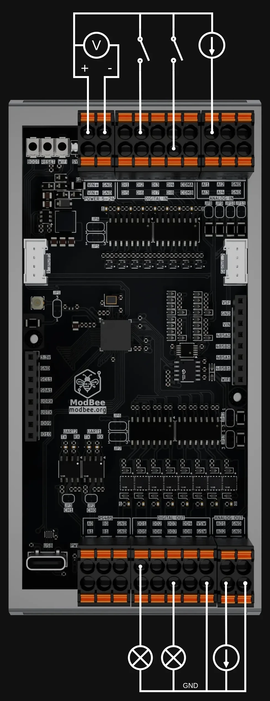

Connect the board's 5–24 V DC supply as well as the USB-C cable. USB-C
alone runs the processor, the upload and the debugger, but not the I/O: the
outputs and the analog outputs are powered from the supply, and the switches
on the inputs need it too.

The status LED shows green when the board's I/O has started, and red when
it has not. If it is red, check the supply and press **Reset** on the board:
the board checks its I/O once, when it starts.

You can build and compile the program without a board. You only need the
Node UIO on USB-C for the upload.

## Ladder in one minute

A Ladder program is a list of **rungs**, run from top to bottom on every
scan. Each rung reads left to right, like an electrical circuit:

- a **contact** `| |` passes power when its variable is on;
- a **coil** `( )` switches its variable on while power reaches it;
- a **block** does more, such as a timer, or reading the board's inputs.

The program you will build has five rungs:

| Rung | Does |
| --- | --- |
| 1 | `UIO` block **Board**: brings the board up and exchanges the I/O on every scan |
| 2 | `DIGITAL_IN` block **Inputs**: the eight digital inputs, `Inputs.DI01` to `Inputs.DI08` |
| 3 | Contact `Inputs.DI01` drives coil `Lamp` |
| 4 | Contact `Inputs.DI02` starts the 5 s timer **PumpDelay**, which drives coil `Pump` |
| 5 | `DIGITAL_OUT` block **Outputs**: `Lamp` to DO1 and `Pump` to DO2 |

The order matters. `UIO` comes first. Then the blocks that read inputs, then
your logic, and the blocks that drive outputs come last. That way, every scan
works on one consistent picture of the inputs.

## Rung 1: the board

1. Open the program **main** from the project tree, then click
   **Create new rung** (the **+** at the right). An empty rung appears, with
   the power rails left and right.

   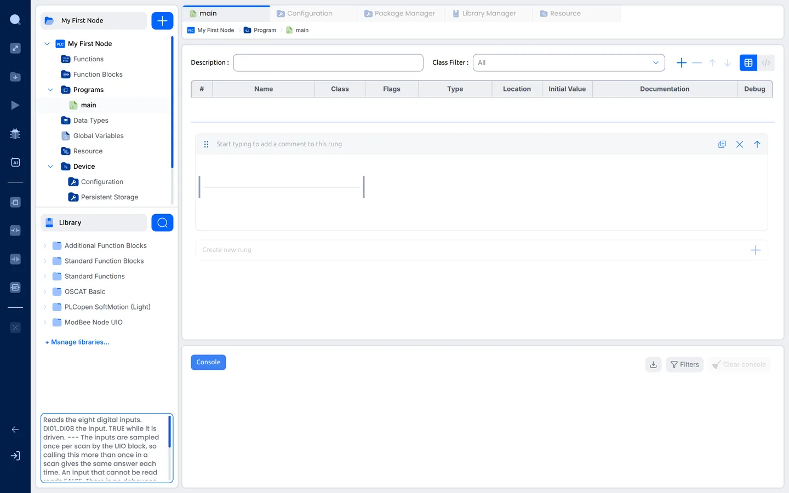

2. Right-click on the rung. A round menu opens with **Contact**, **Coil** and
   **Block**.

   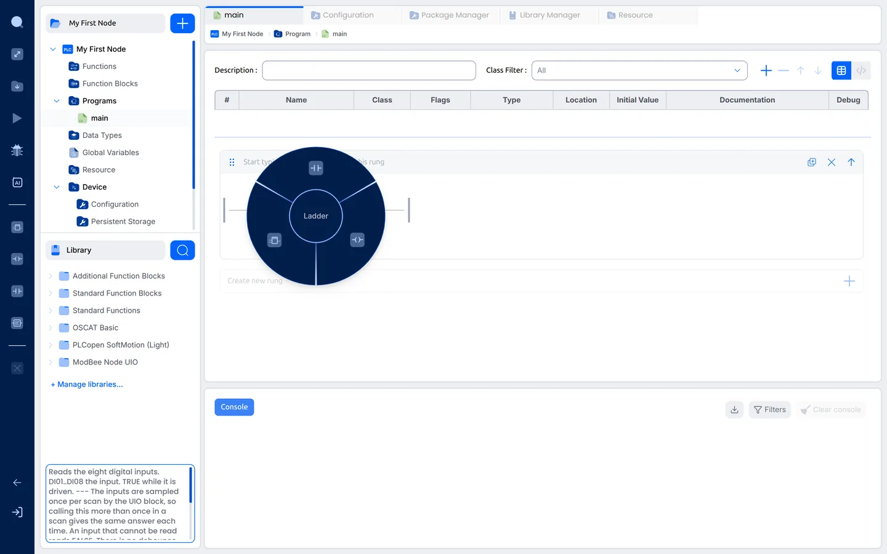

   Shortcuts: Alt+1 contact, Alt+2 coil, Alt+3 block (⌘ instead of Alt on a
   Mac).

3. Click **Block**. The block follows the mouse, and small marks show where it
   can go on the rung. Click on a mark.

   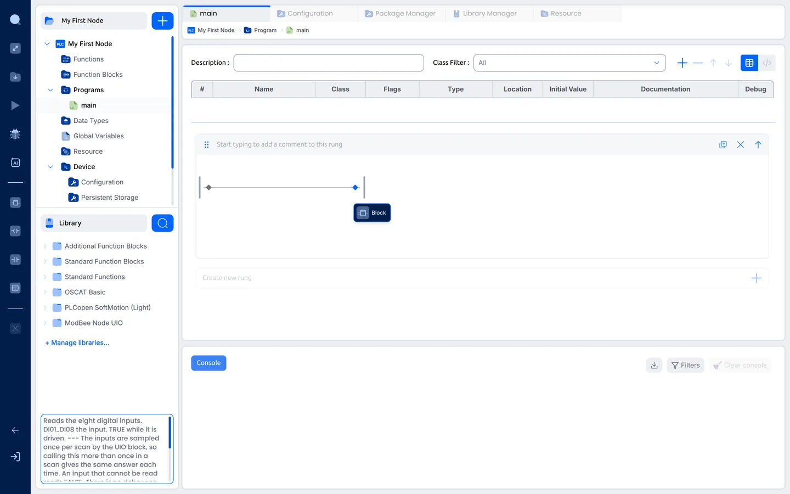

4. Type the block's type, `UIO`, into the block, and press Enter.

   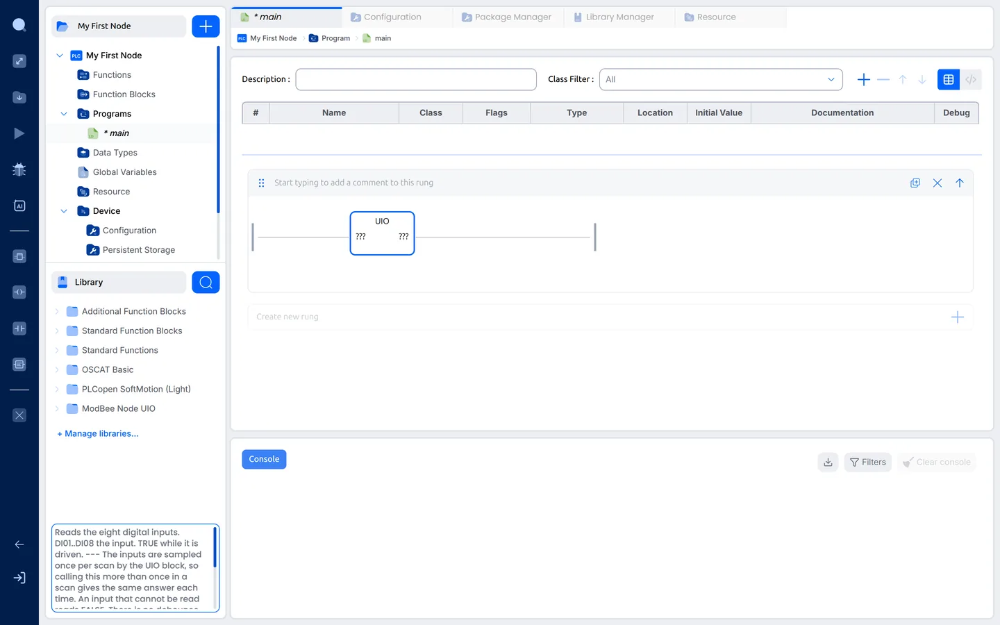

   The block gets its pins, and the editor declares a variable for it in the
   variables table, `UIO0` of type `UIO`. That variable is the block's
   **instance**: its own memory, kept from one scan to the next.

5. Give the instance a meaningful name. In the variables table, click the
   `UIO0` row, then click its name, type `Board` and click outside the table.
   The editor asks whether to update the diagram as well. Click
   **Yes, rename references**.

   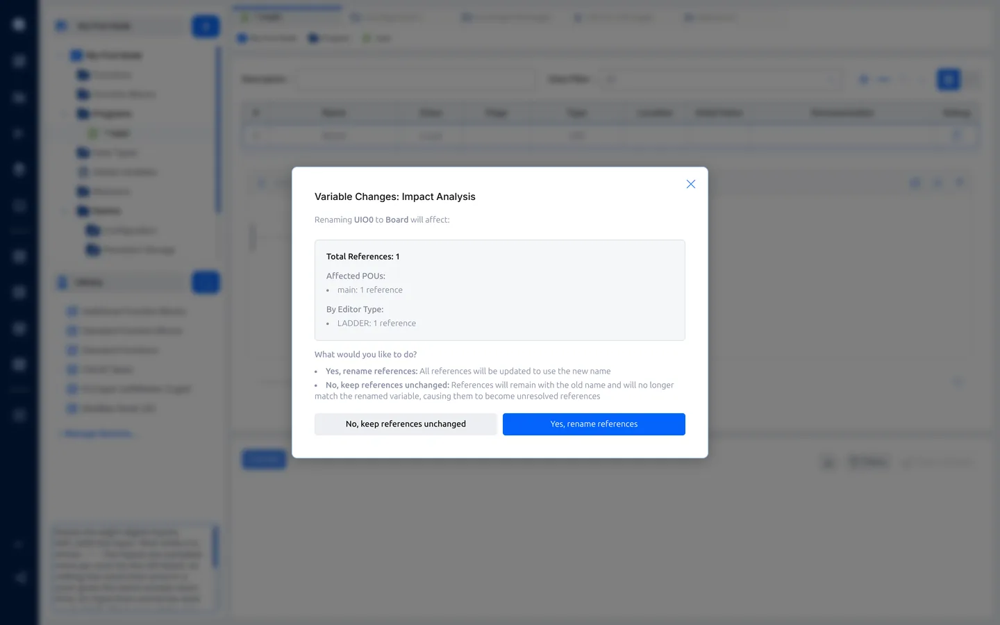

6. Click *Start typing to add a comment to this rung* and describe the rung.
   Comments make the program readable for the next person.

   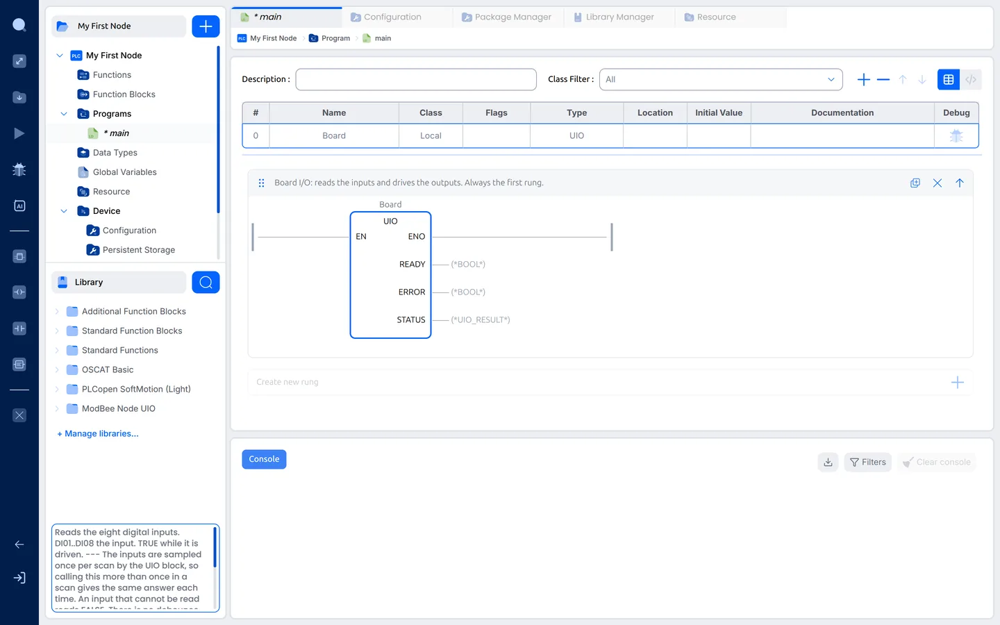

`READY` turns on once the board's I/O chips have answered. `ERROR` and
`STATUS` say why if they don't. Leave them empty for now.

## Rung 2: the inputs

Add a rung the same way. Place a block, type `DIGITAL_IN` and rename its
instance to `Inputs`.

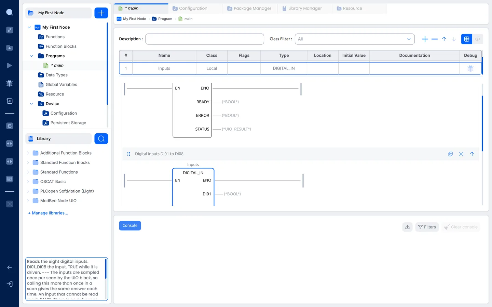

Its outputs `DI01` to `DI08` are the eight inputs. You use them as
`Inputs.DI01`, `Inputs.DI02` and so on.

## Rung 3: the lamp

1. Add a rung. Right-click, choose **Contact** and place it. Type
   `Inputs.DI01` and press Enter.

   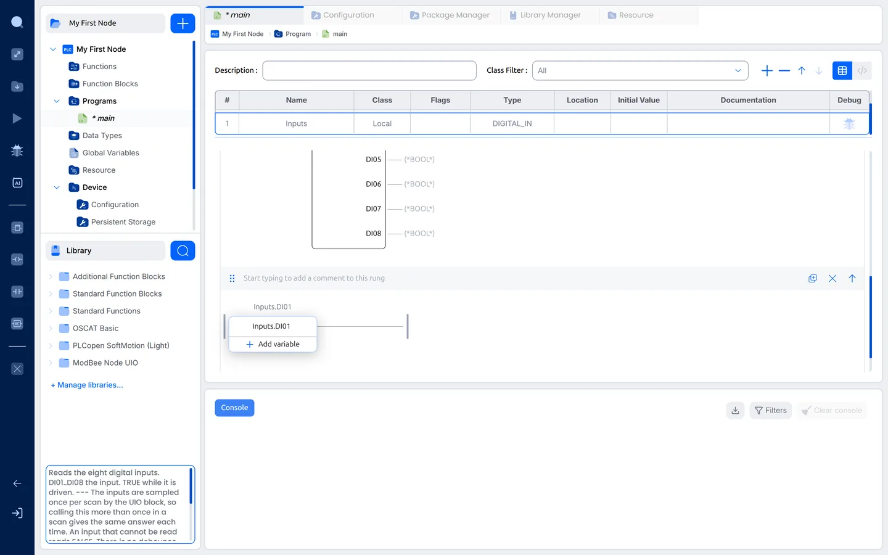

2. Right-click, choose **Coil** and place it on the mark to the right of the
   contact. Type `Lamp` and press Enter. `Lamp` does not exist yet, so the
   editor declares it for you, as a `BOOL` (on or off).

   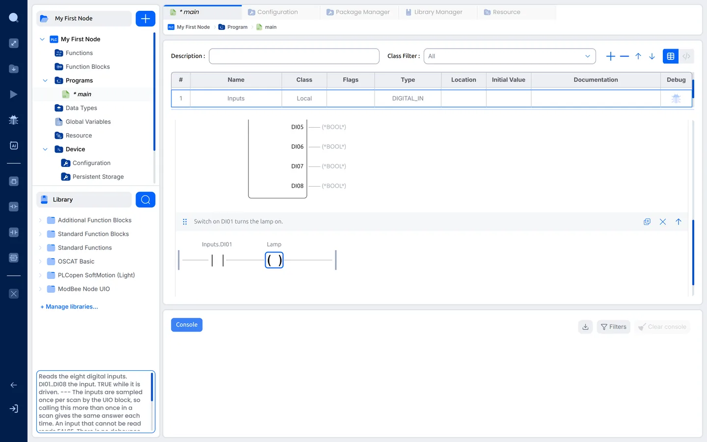

## Rung 4: the pump, after 5 seconds

1. Add a rung with a contact on `Inputs.DI02`.
2. Place a block to the right of the contact and type `TON`: the standard
   on-delay timer. Rename its instance to `PumpDelay`.
3. Click the empty field on the timer's `PT` pin, type `T#5s` (5 seconds, in
   IEC time notation) and press Enter.
4. Place a coil to the right of the timer and type `Pump`.

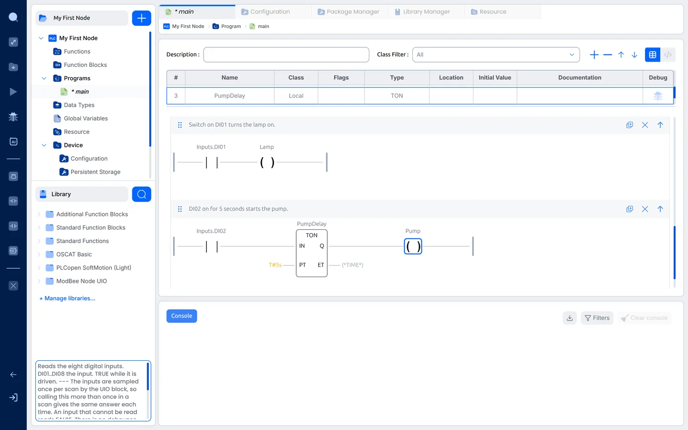

The timer's output `Q` turns on when its input `IN` has been on for the time
`PT`. If DI2 goes off sooner, the timer starts again from zero. `ET` shows the
time so far.

## Rung 5: the outputs

1. Add a rung with a `DIGITAL_OUT` block and rename its instance to `Outputs`.
2. Click the field on the `DO01` pin and start typing `Lamp`. The editor lists
   the variables that fit. Click **Lamp**.

   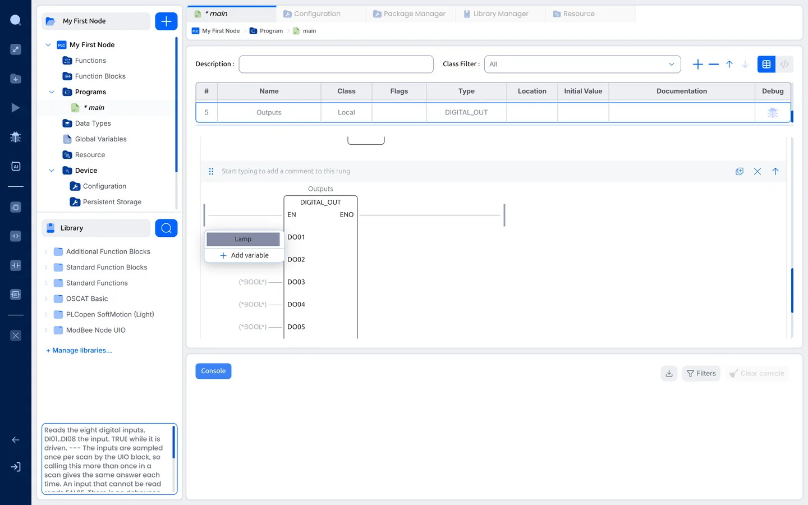

3. Click an empty part of the rung, then do the same on `DO02` with **Pump**.

   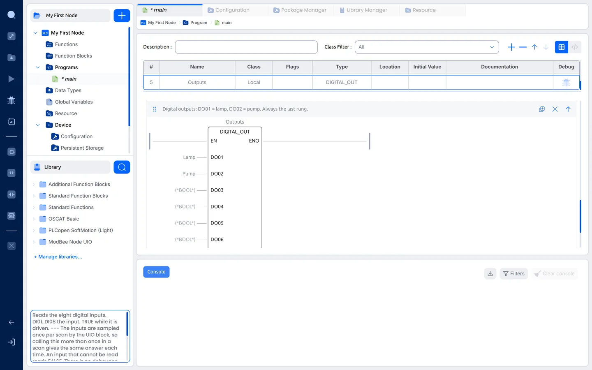

Save the project: **File › Save Project** (Ctrl+Shift+S).

## Compile

Click the **Build** button in the tool bar on the left, the arrow pointing
down into a tray. It offers:

- **Build only:** compile without uploading. Use it to check the program
  without a board.
- **Build and upload:** compile and upload to the board.
- **Clean build and upload:** the same, starting from scratch.

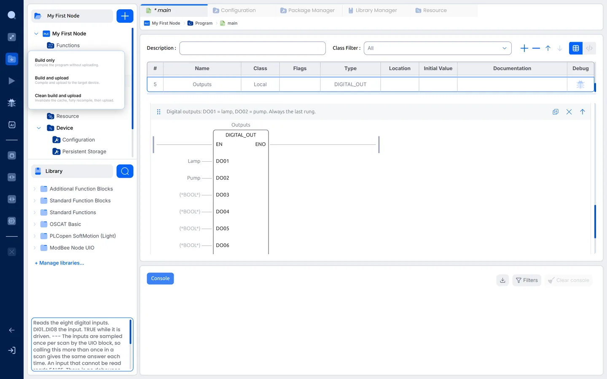

Click **Build only**. The console follows the build. The first build of a
Node UIO project takes several minutes while the ESP32 tools compile. Later
builds are much quicker.

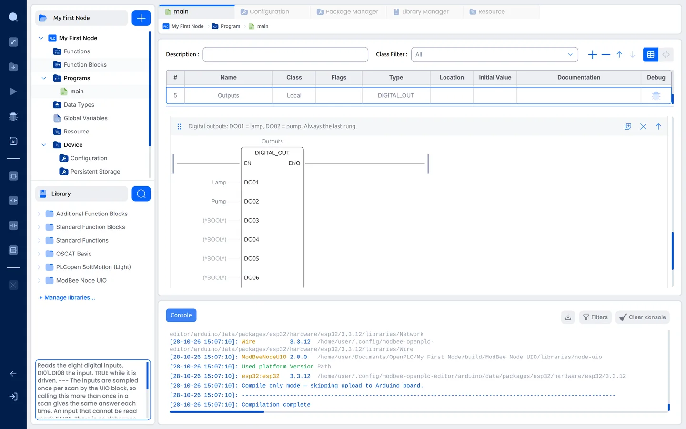

`Compilation complete` means the program is good. Scroll up a little to find
how much of the board's memory the program uses (*Sketch uses …* and
*Global variables use …*). If the build stops with an error, the console names
the program, the line and the problem, for example a variable that does not
exist.

## Upload

1. Plug the Node UIO into your computer with a USB-C cable.
2. Open **Device › Configuration**. Click the refresh arrow next to
   **Communication Port**, and pick the port the Node UIO appeared on. On
   Linux it is `/dev/ttyACM0` (ESP32 Family Device), on Windows a `COM` port.

   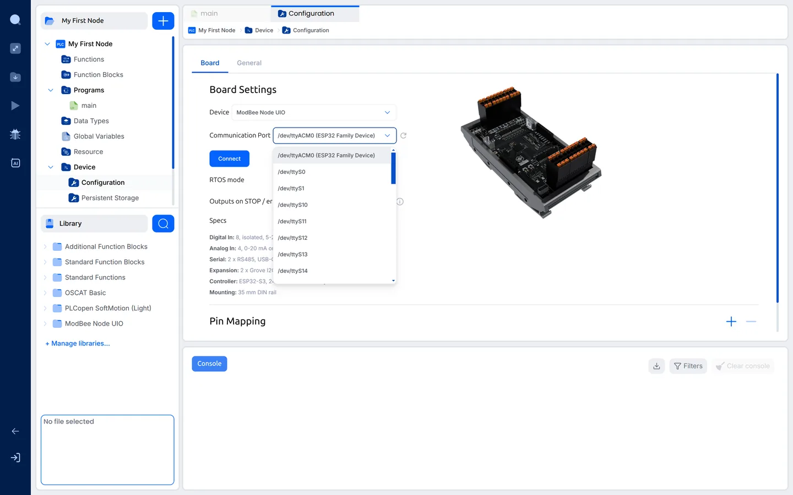

3. Save the project, then click **Build** › **Build and upload**. The
   console shows the build, then the upload. It ends with
   `Arduino upload complete.` and the board restarts with your program.

   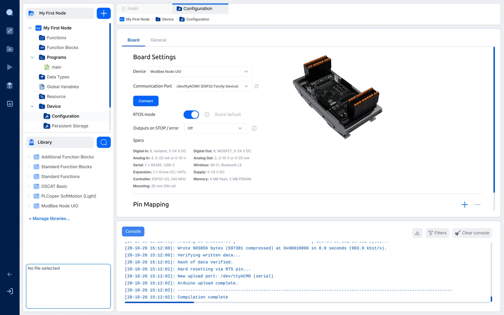

Your program now runs on the Node UIO by itself, and it starts again after a
power cut. Switch DI1 on and DO1 comes on. Hold DI2 on for 5 seconds and DO2
comes on.

## Watch it run

The debugger shows the program running on the board, live, over the USB-C
cable.

1. Click the **Debugger** (the bug) in the tool bar on the left. The editor
   asks to connect to the board. Click **Yes**. The console shows
   `status -> connected`.
2. Click the **Debugger** again to start the live view, and open the program
   **main**.

The rungs now show the values in the board. A wire that carries power turns
green, so you can follow it through each contact and coil. Blocks show their
values beside the pins, such as `PT` and `ET` on the timer. The picture below
has DI1 switched on: the contact `Inputs.DI01` is closed and the `Lamp` coil
is on.

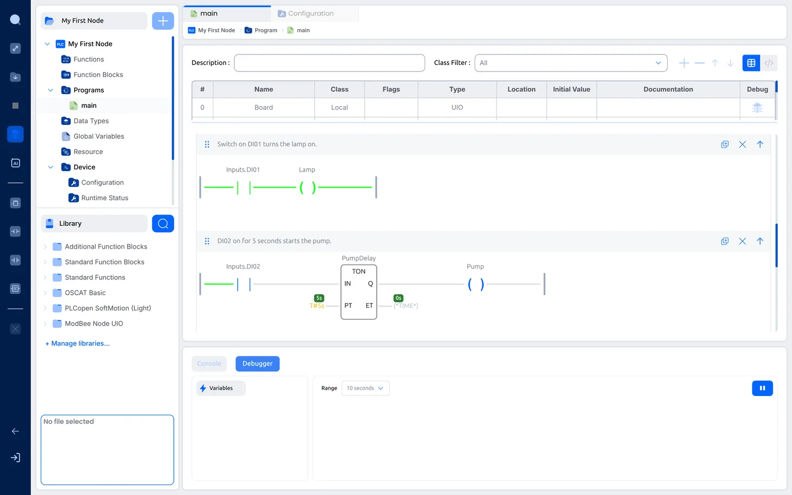

- Switch DI1 on: `Inputs.DI01` and `Lamp` turn on, and the lamp on DO1
  lights.
- Switch DI2 on: `PumpDelay.ET` counts up, and after 5 seconds `Pump` and DO2
  come on.

Next: [5. Next steps](05-next-steps.md)
